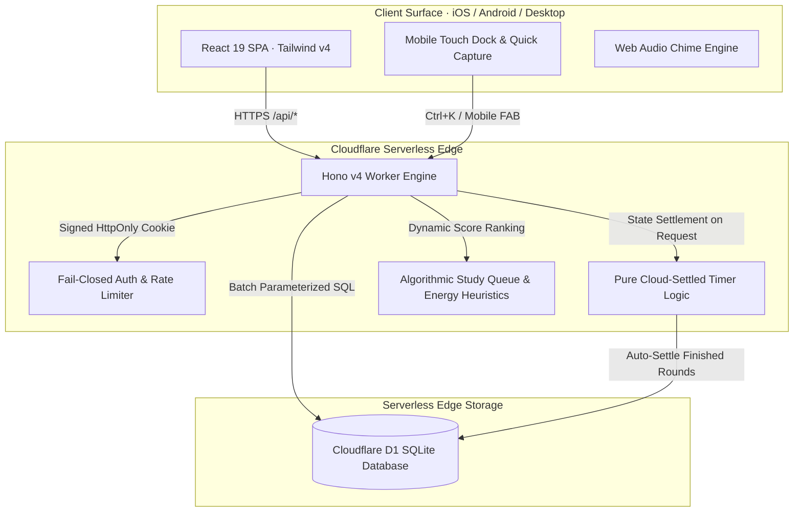

# ⚡ Exam Tracker & Life OS

[](https://workers.cloudflare.com/)
[](https://developers.cloudflare.com/d1/)
[](https://react.dev/)
[](https://tailwindcss.com/)
[](https://www.typescriptlang.org/)
[](https://vitest.dev/)
[](audit/run-audit.ts)

A unified **CBSE Class 10 exam preparation dashboard and personal Life OS** engineered for high-performance study execution. Built from the ground up to run on Cloudflare's serverless edge, combining automated algorithmic revision scheduling, cloud-settled Pomodoro focus telemetry, habit streak mechanics, and school deliverable tracking in a private, zero-maintenance architecture.

**Live Deployment:** [study.advaitachandra.in](https://study.advaitachandra.in) *(Private · 6-digit PIN required)*

---

## 🏛️ System Architecture



---

## 🌟 Core Feature Suite

### 1. 🎯 Mission Control (Today View)
- **Daily Momentum Telemetry Ribbon**: Real-time 4-card overview displaying Targets completion percentage, Focus minutes logged with live pulse dot, Habit progress with streak counter, and Morning Kickoff/Routine status.
- **Apple Pro Countdown Widget**: Large tabular countdown to the upcoming exam phase (Pre-Boards 1, Pre-Boards 2, Practicals & Viva, or Board Exams) with interactive phase switcher, specular sheen reflection, and elapsed time meter.
- **Interactive Daily Targets**: Auto-suggests the 3 highest-priority chapters every morning (capped at 8). Features continuous gradient progress tracking, celebratory completion banner, and **1-click Focus launcher** that pre-configures the timer to that target's subject.
- **Algorithmic Study Queue**: Ranks every chapter dynamically based on test urgency and student confidence. Includes **1-click `+ Plan today`** promotion into daily targets.
- **Companion Daily Habits**: Check off daily habits and increment steppers directly on Today without navigating away.
- **Energy Check-In**: Log energy level (Low, OK, High) once daily; the algorithm dynamically swaps open targets for lighter or more challenging chapters to match cognitive capacity.

### 2. ⏱️ Cloud-Settled Edge Pomodoro Focus Hub
- **D1 Cloud Settlement**: Timer state lives on the serverless edge in Cloudflare D1. You can start a session on your laptop, close the lid, and check your phone—the server settles completed rounds automatically on the next request.
- **Standard Protocol**: 25-minute focus intervals, 5-minute short breaks, and a 15-minute long break after every 4th session. Stopping early saves actual minutes studied.
- **Sensory Feedback**: Ambient luminous glow ring (`[filter:drop-shadow(0_0_8px_rgba(94,92,230,0.5))]`), live pulsing status badge, browser tab title countdown, subtle Web Audio bell chime, and mobile haptic vibration.
- **Adaptive Layout**: Embedded full card on desktop, floating sticky timer bar above mobile dock.

### 3. 📚 Dynamic Syllabus & Multi-Pass Revision Engine
- **Scope Hierarchy**: Filter chapters by exam level: `Unit 1`, `Unit 2`, `PB1` (Pre-Boards 1), `PB2` (Pre-Boards 2), and `Boards`. A phase covers its own scope and all levels below it.
- **3-Pass Mastery**: Tracks **Concept**, **PYQs & Exemplar**, and **Sample Papers** per chapter. A chapter with all 3 passes completed gracefully drops out of the study queue.
- **Confidence Matrix**: 1-to-5 confidence rating. Shakier chapters in subjects being tested soonest are mathematically prioritized.
- **Tactile Reordering**: Drag-and-drop or keyboard arrow nudge (Up/Down) to reorder chapter priority.
- **Syllabus Verification**: "Mark as checked" badge against the official school PDF syllabus.
- **Exam Dates Manager**: Maintains independent exam dates per subject for each exam phase.

### 4. 🧬 Personal Life OS (Habits, Routines & Quick Capture)
- **Habits Tracker**: Supports boolean check-offs and numeric daily steppers (e.g. 50 pushups, 20 math problems). Protected by optimistic FIFO promise queues to prevent dropped clicks during rapid tapping.
- **Streak & 7-Day Sparklines**: Consecutive day streak tracking with radiant activity dots (`shadow-[0_0_8px_rgba(52,211,153,0.35)]`).
- **Morning Kickoff & Evening Shutdown**: Sleep quality rating (😴 Poor, 🥱 Short, 😐 OK, 🙂 Good, 🌟 Great), wake-up timestamp, and shut-down reflection stamp.
- **Quick Capture Drawer**: Global `Ctrl + K` (desktop) or floating action button (mobile) to capture urgent notes and to-dos in seconds.
- **Projects**: Track personal hobbies, creative projects, and fitness targets broken into progressive milestone checklists.

### 5. 📊 Analytics, Heatmaps & Weekly Review
- **Weekly Study Time & Energy Distribution**: 7-day visual bar charts comparing study minutes alongside logged energy.
- **Study vs. Habits Correlation**: Side-by-side table tracking study duration, habits completed, and sleep ratings.
- **12-Week Heatmaps**: GitHub-style 84-day dual heatmaps for both study duration and daily habit consistency.
- **Weekly Reflection**: Persistent weekly review textarea saved automatically on blur with double-submit locking.

### 6. 🎒 Deliverables & Viva Prep Manager
- Tracks school assignments and portfolio submissions for the active phase (e.g. Maths Lab activities, Science practical files, English ASL).
- Multi-step activity steppers, due date countdowns, overdue warnings, and viva-prep flags.

---

## 🎨 Design System & Aesthetics

Crafted according to the **Apple Human Interface Guidelines**, **OLED Pro** dark mode, and modern design engineering standards:
- **Obsidian Black Canvas (`#000000`)**: Pure OLED black for maximum contrast and battery conservation on mobile displays.
- **Elevated Apple Dark Sheets**: Multi-tiered depth using `--surface: #121214`, `--surface2: #1c1c1e`, and `--line: #2c2c2e`.
- **Apple Ceramic Light Theme**: Pure white cards (`#ffffff`) on ceramic canvas (`#f5f5f7`) with graphite ink (`#1d1d1f`).
- **Apple System Color Tokens**: System Indigo (`#5e5ce6`), Activity Green (`#30d158`), System Orange (`#ff9f0a`).
- **Apple Segmented Controls**: Interactive pill segments with illuminated active backings and instant tactile response.
- **Critically Damped Motion**: All transitions follow Apple's physical spring curve `cubic-bezier(0.16, 1, 0.3, 1)`.
- **Offline Resilience**: Automatic `navigator.onLine` synchronization with non-intrusive status banners and dismissable error alerts.

---

## 🔒 Security & Edge Invariants

| Principle | Implementation Detail |
|---|---|
| **Fail-Closed Auth** | If `STUDY_PASSCODE` or `SESSION_SECRET` is unset, the Worker immediately halts and rejects all requests with HTTP 500. |
| **Constant-Time PIN Matching** | Passcodes are verified using `crypto.subtle.timingSafeEqual` (`same()`) to eliminate timing side-channel attacks. |
| **Sliding Lockout Engine** | 5 consecutive wrong PIN attempts lock the client IP for 15 minutes. 20 consecutive failures across all IPs trigger a global 1-hour lockout. |
| **Signed HttpOnly Cookies** | HMAC-SHA256 signed session cookies (`SameSite=Strict`, `HttpOnly`, `Secure`). 90 days with "Remember me", 24 hours otherwise. |
| **D1 SQL Parameterization** | Zero string interpolation in SQL queries. Strict usage of `db.prepare(...).bind(...)` and atomic `db.batch([...])`. |
| **IST Timezone Invariant** | All calendar day calculations, streak resets, and target generations strictly use Indian Standard Time (`Asia/Kolkata`, UTC+5:30) via `todayIST()`. |
| **React 19 Form Concurrency** | All form field IDs use `useId()` to prevent DOM collisions. Rapid submissions are guarded by `busy.current` `useRef` locks. |

---

## 📂 Project Structure

```
d:\Project\exam-tracker\
├── context/               # 🧠 Universal AI & Developer Context
│   ├── RULES.md           # Mandatory system invariants (IST, D1, Auth, React 19)
│   ├── ARCHITECTURE.md    # System architecture, data flow & file roles
│   ├── VERIFICATION.md    # Build, test, and audit verification checklist
│   └── DECISIONS.md       # Append-only architectural memory & decision log
├── server/                # ⚡ Cloudflare Worker Backend (Hono v4)
│   ├── index.ts           # Worker entry point & fetch router
│   ├── app.ts             # Hono router, API routes (/api/*), D1 batch queries
│   ├── auth.ts            # PIN verification, signed cookies, lockout rate limiter
│   ├── logic.ts           # Pure domain math: todayIST, daysLeft, rankNext
│   ├── planner.ts         # Study queue ranking & energy check-in heuristics
│   ├── timer.ts           # Pure Pomodoro state engine (settleTimer, startFocus)
│   ├── life.ts            # Habits, quick capture, projects, routine handlers
│   └── testdb.ts          # Test harness with in-memory Miniflare D1
├── src/                   # 🖥️ Frontend SPA (React 19 + Tailwind v4)
│   ├── App.tsx            # Main shell, responsive dock, polling & offline sync
│   ├── Today.tsx          # Telemetry ribbon, countdown, targets, queue, habits widget
│   ├── Syllabus.tsx       # Subject & chapter tree, revision passes, scope filter
│   ├── Focus.tsx          # Pomodoro focus card & bar, Web Audio chime engine
│   ├── Habits.tsx         # Daily habits tracker, sparklines & streak counts
│   ├── Routine.tsx        # Morning kickoff & evening shutdown
│   ├── Capture.tsx        # Quick capture drawer (Ctrl + K)
│   ├── Projects.tsx       # Personal projects & milestone checklist
│   ├── Week.tsx           # 12-week study & habit heatmaps, weekly reflection
│   ├── Deliverables.tsx   # School submissions & activity steppers
│   ├── Backup.tsx         # Version 5 JSON export / atomic restore & theme switcher
│   ├── api.ts             # Type-safe client fetch wrapper & error handling
│   ├── ui.tsx             # Shared design system components & Apple SVG icons
│   └── index.css          # Design tokens, Apple palettes, glassmorphism utilities
├── migrations/            # 🗄️ D1 SQLite Schema Migrations (0001_init ... 0008_life_os)
├── audit/                 # 🔍 Automated Code Review & Security Audit Engine
│   └── run-audit.ts       # Validates secrets, concurrency, schemas, and types
├── wrangler.jsonc         # Cloudflare Workers & D1 deployment configuration
└── vite.config.ts         # Vite bundler & Tailwind CSS v4 setup
```

---

## 🛠️ Local Development

### Prerequisites
- Node.js 20+
- npm 10+

### Step-by-Step Setup

1. **Clone the repository and install dependencies:**
   ```bash
   git clone https://github.com/w1tneess/study-dashboard.git
   cd exam-tracker
   npm install
   ```

2. **Configure environment variables:**
   ```bash
   cp .dev.vars.example .dev.vars
   ```
   *(Ensure `STUDY_PASSCODE`, `SESSION_SECRET`, and `APP_TOKEN` are set in `.dev.vars`)*

3. **Initialize the local D1 SQLite database:**
   ```bash
   npm run db:local
   ```
   *This applies all migrations in `migrations/*.sql` and seeds the syllabus data.*

4. **Start the local edge development server:**
   ```bash
   npm run dev
   ```
   *Open [http://localhost:8787](http://localhost:8787) in your browser. This boots the Worker, Vite client assets, and local D1 SQLite.*

---

## 🧪 Testing & Verification

The repository enforces a strict verification pipeline before any production deployment:

```bash
# 1. Run dual TypeScript compilation (client + server) & Vite bundle check
npm run build

# 2. Run complete Vitest integration test suite (Miniflare in-memory D1)
npm test

# 3. Run automated security, concurrency, and architecture audit engine
npm run audit
```

- **Integration Tests**: 129 tests across 8 test suites verifying authentication, sliding rate limits, Pomodoro cloud settlement, study queue scoring, habit streaks, atomic backups, and schema integrity.
- **Audit Engine**: Validates fail-closed secrets, React 19 `useId()` and double-submit guards, D1 query parameterization, and memory log updates.

---

## 🚀 Cloud Deployment

### 1. Automated CI/CD (Recommended)
Every push to `main` triggers `.github/workflows/ci.yml`:
1. Dual TypeScript check and Vite build.
2. Full test suite execution against local D1.
3. Automated code audit.
4. Cloudflare D1 production migrations (`npm run db:remote`).
5. Cloudflare Workers publication via Wrangler (`npm run deploy`).

*Requires the `CLOUDFLARE_API_TOKEN` GitHub repository secret (Worker Deploy + D1 Edit permissions).*

### 2. Manual CLI Deployment

```bash
# Log in to Cloudflare
npx wrangler login

# Apply schema migrations to remote D1
npm run db:remote

# Configure production secrets
npx wrangler secret put STUDY_PASSCODE   # Your 6-digit PIN
npx wrangler secret put SESSION_SECRET   # Random 32+ character signing string
npx wrangler secret put APP_TOKEN        # Recovery bearer token

# Build and deploy Worker + static assets
npm run deploy
```

---

## 💾 Backup & Data Portability

Exam Tracker supports full, atomic JSON export and restoration via the **Backup** screen:
- **Export (`GET /api/export`)**: Downloads an encrypted, complete snapshot of all subjects, chapters, revision passes, daily targets, check-ins, focus logs, habits, captures, projects, and weekly reviews.
- **Atomic Import (`POST /api/import`)**: Validates schema integrity and restores the entire database in a single atomic transaction.
- **Automatic Version Upgrades**: Restoring older backup schemas (v1–v4) seamlessly upgrades legacy data into the current Version 5 Life OS format.

---

## 📜 Invariants & Directives

All contributors and AI agents must adhere to the core directives defined in [`context/RULES.md`](context/RULES.md):
1. **IST Timezone (`Asia/Kolkata`)**: Never compute calendar days using UTC. Always use `todayIST(nowMs)`.
2. **D1 Parameterization**: Never interpolate raw strings into SQL. Always use `db.prepare(...).bind(...)`.
3. **Fail-Closed Security**: Reject requests with HTTP 500 if secrets are missing.
4. **React 19 Standards**: Always use `useId()` for form fields and `useRef` `busy.current` double-submit locks.
5. **Zero New Runtime Dependencies**: Keep the bundle lean and native.
6. **Mandatory Memory Logging**: Every task requires an entry appended to [`context/DECISIONS.md`](context/DECISIONS.md).

---

## 👤 Author & Maintainer

**Advaita Chandra**  
- Website: [advaitachandra.in](https://advaitachandra.in)  
- Application: [study.advaitachandra.in](https://study.advaitachandra.in)  
- License: Private / All Rights Reserved
