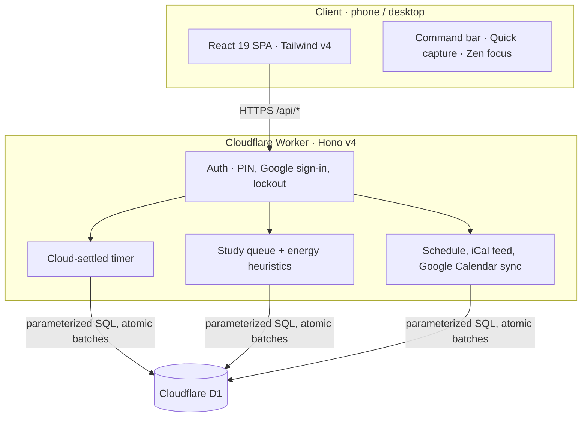

# Exam Tracker & Life OS

[](https://workers.cloudflare.com/)
[](https://developers.cloudflare.com/d1/)
[](https://react.dev/)
[](https://tailwindcss.com/)
[](https://www.typescriptlang.org/)
[](https://vitest.dev/)

A private **CBSE Class 10 exam-prep dashboard and personal Life OS**. It runs entirely on Cloudflare's edge (Worker + D1) and combines a ranked study queue, a cloud-settled Pomodoro timer, three-pass chapter revision, habits, a daily schedule synced with Google Calendar, and school deliverable tracking.

**Live:** [study.advaitachandra.in](https://study.advaitachandra.in) *(private; PIN or allow-listed Google sign-in)*

---

## Architecture



The Worker serves `/api/*` and the built SPA from `./dist`. All state is in D1; the client refreshes every 20 seconds and when the tab regains focus, so phone and laptop stay in step.

---

## Features

The app has four places to go: **Today**, **Study**, **Plan** and **Life**. Plan and Life hold sub-pages, shown as tabs under the header. Old `#hash` links still work.

### Today
- **Today**: one "Next up" card (a chosen target, else the top of the study queue) with Start focus, Mark done and Quiz me. Below it: today's plan, suggested chapters, what's due soon, and habits you can tick without leaving the page.
- **Overview**: the bird's-eye view. Tiles for days to the exams, share of the syllabus started, study time over the last 7 days against the 7 before, and the study streak. Also a 14-day study chart, a progress bar per subject, the next exam dates for the active phase, and the five least-confident chapters.

### Study
- **Syllabus** across 11 subjects, with a scope filter (`Unit 1`, `Unit 2`, `PB1`, `PB2`, `Boards`). A phase covers its own scope and everything below it.
- **Three revision passes** per chapter: Concept, PYQs & Exemplar, Sample papers. A chapter with all three done drops out of the study queue.
- **Confidence 1 to 5** per chapter. Shakier chapters in subjects tested soonest rank first.
- **Revision matrix** to see passes across a subject at a glance.
- **Quiz me (viva drawer)**: an active-recall drawer for a chapter, opened from Today, Due dates or the command bar.
- **Exam dates** per subject for each exam phase, and "Mark as checked" against the official school syllabus.

### Plan
- **Schedule**: a daily timetable of blocks (morning, school, revision, practice, wind-down, custom), with warnings when a block clashes with a calendar event.
- **Calendar**: a private iCal feed (its own random token, resettable from the calendar dialog) and optional **Google Calendar sync**.
- **Due dates**: school deliverables with steppers for countable work, overdue warnings and viva-prep flags.
- **Review**: weekly study and energy chart, study against habits and sleep, 12-week heatmaps and a weekly reflection saved on blur.

### Life
- **Habits**: tick or counter habits with streaks and a 7-day strip.
- **Projects**: personal projects with milestone checklists.
- **Routine**: morning kickoff and evening shutdown, with a sleep rating.
- **Quick capture**: notes and to-dos from anywhere.

### Everywhere
- **Pomodoro focus**: 25-minute rounds, 5-minute breaks and a 15-minute long break after every 4th round. State lives in D1, so a round started on one device is settled by the server and visible on the others. Stopping early saves the minutes actually studied.
- **Zen focus studio**: a full-screen timer with ambient sound.
- **Command bar** (`Ctrl/Cmd + K`) for quick actions and navigation.
- **Keyboard shortcuts** (outside text fields): `C` capture, `F` Zen focus, `Space` start or stop focus, `1` to `4` Today / Syllabus / Schedule / Habits.
- **Light and dark themes**, an offline banner, and a dismissable error bar.

---

## Security

| Principle | Implementation |
|---|---|
| Fail closed | If `STUDY_PASSCODE` or `SESSION_SECRET` is unset, the Worker answers 500 to everything. |
| Constant-time PIN check | Compared with a timing-safe equality. |
| Lockout | 5 wrong PINs lock an IP for 15 minutes; 20 across all IPs lock everyone for an hour. The attempt is recorded before the check, in one atomic batch. |
| Sessions | HMAC-signed `HttpOnly`, `SameSite=Strict`, `Secure` cookie. 90 days with "Remember me", 24 hours otherwise. Cookie writes also check the `Origin`. |
| Google sign-in | Optional. Only addresses in `ALLOWED_GOOGLE_EMAILS` are admitted, and the OAuth state is bound to the browser. |
| Recovery token | `APP_TOKEN` works as a bearer token for scripts and recovery. |
| Backups carry no secrets | Google credentials, the calendar token and the sign-in allow-list are left out of exports and ignored on restore. |
| SQL | Parameterized (`db.prepare(...).bind(...)`) with atomic `db.batch([...])`. |
| IST | Day boundaries, streaks and targets use `Asia/Kolkata` through `todayIST()`. |

---

## Project structure

```
exam-tracker/
├── context/          Rules, architecture, verification checklist, decision log
├── server/           Cloudflare Worker (Hono v4) and its tests
│   ├── app.ts        Routes, state assembly, export/import
│   ├── auth.ts       PIN, Google sign-in, sessions, lockout
│   ├── logic.ts      Pure domain maths (todayIST, daysLeft, ranking)
│   ├── planner.ts    Study queue and energy heuristics
│   ├── timer.ts      Pomodoro state engine
│   ├── life.ts       Habits, capture, projects, routine
│   ├── calendar.ts   Schedule blocks, iCal feed, conflicts
│   ├── google-calendar.ts  Google Calendar sync
│   ├── curriculum.ts Official chapter lists
│   └── testdb.ts     Tests run against a real local D1
├── src/              React 19 SPA
│   ├── App.tsx, nav.ts       Shell, routing, shortcuts
│   ├── Today.tsx, Overview.tsx, overviewStats.ts
│   ├── Syllabus.tsx, RevisionMatrix.tsx, VivaDrawer.tsx
│   ├── Schedule.tsx, CalendarModal.tsx, GoogleSyncModal.tsx
│   ├── Deliverables.tsx, Week.tsx
│   ├── Habits.tsx, Projects.tsx, Routine.tsx, Capture.tsx
│   ├── Focus.tsx, ZenFocus.tsx, CommandBar.tsx
│   └── ui.tsx, index.css     Shared components and design tokens
├── migrations/       D1 schema, 0001_init to 0014_deliverables_real_dates
├── audit/            Optional static audit (npm run audit)
└── wrangler.jsonc    Worker, D1 binding and non-secret config
```

---

## Local development

Needs Node.js 20+ (CI uses 24).

```bash
git clone https://github.com/w1tneess/study-dashboard.git
cd study-dashboard
npm install
cp .dev.vars.example .dev.vars   # set STUDY_PASSCODE, SESSION_SECRET, APP_TOKEN
npm run db:local                 # apply migrations to the local D1
npm run build                    # the Worker serves ./dist
npm run dev                      # http://localhost:8787
```

`npm run dev:web` runs Vite alone for front-end work. Google sign-in and calendar sync also need `GOOGLE_CLIENT_ID`, `GOOGLE_CLIENT_SECRET` and the redirect URIs from `.dev.vars.example`; the app works without them.

---

## Testing

```bash
npm run build   # type-check client and server, then bundle
npm test        # 170 tests in 11 files, against a real local D1
npm run audit   # optional static checks (not run in CI)
```

Tests cover auth and lockout, the timer, the study queue and phases, habits and streaks, the calendar and Google sync, backups (including the secrets rules), and the Overview numbers.

---

## Deployment

Every push to `main` runs `.github/workflows/ci.yml`: build, test, then, if both pass, apply remote D1 migrations and deploy with Wrangler. Migrations are idempotent, so applied ones are skipped. It needs the `CLOUDFLARE_API_TOKEN` repository secret.

Manual deploy:

```bash
npx wrangler login
npm run db:remote
npx wrangler secret put STUDY_PASSCODE
npx wrangler secret put SESSION_SECRET
npx wrangler secret put APP_TOKEN
npm run deploy
```

---

## Backup

The **Backup** screen exports and restores everything as JSON (format version 5):

- `GET /api/export` downloads subjects, chapters, passes, targets, check-ins, sessions, habits, captures, projects, routines, reviews, the schedule and calendar events. Secrets are never included.
- `POST /api/import` validates the file and restores it in one atomic write. A bad file changes nothing.
- Older files (v1 to v4) are upgraded on restore.

---

## Contributor rules

Defined in [`context/RULES.md`](context/RULES.md): IST for every calendar day, parameterized SQL only, fail closed on missing secrets, `useId()` for form fields and `busy.current` guards against double submits, no new runtime dependencies, and a note in [`context/DECISIONS.md`](context/DECISIONS.md) for each change.

---

**Advaita Chandra** · [advaitachandra.in](https://advaitachandra.in) · Private, all rights reserved.
